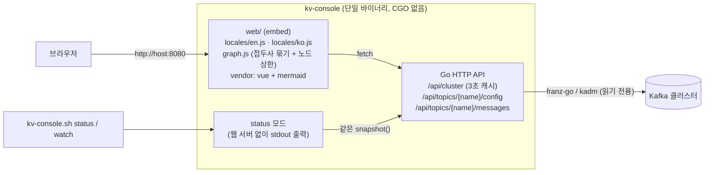
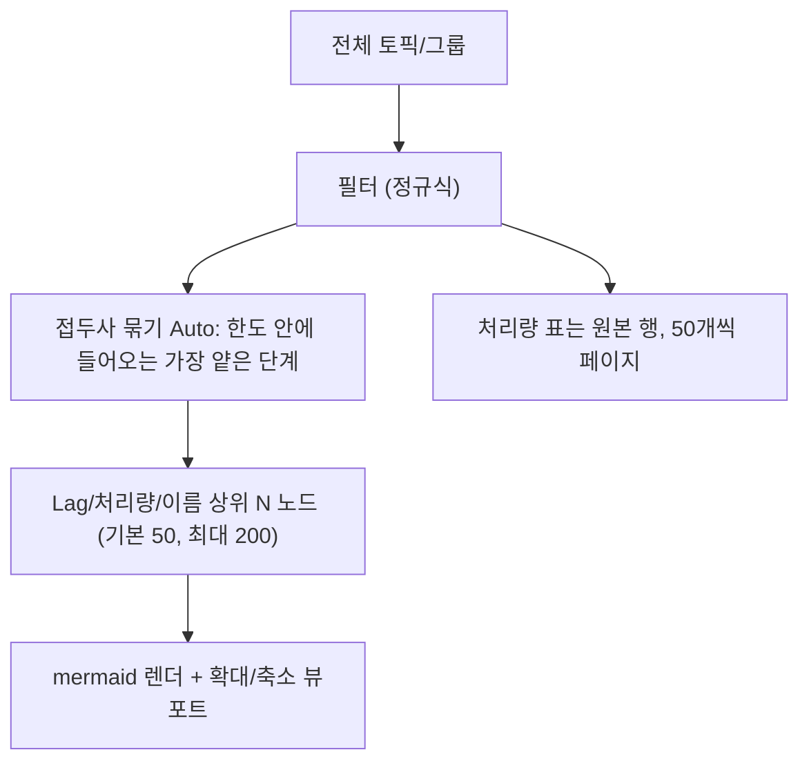

# Kafka V-Console 구현 보고서

- 최초 작성: 2026-10-20 12:55 (UTC+9)
- 갱신: 2026-10-20 13:45. UI 문자열을 `web/locales/{en,ko}.js`로 분리하고 언어 선택기를 달았습니다. 토폴로지는 300+ 토픽에서도 접두사 묶기 + 노드 상한 + 확대/축소 + 표 페이지로 보도록 바꿨습니다.
- 목표: Redpanda Console의 핵심 조회 기능을 유지하면서, 토픽과 컨슈머 그룹의 관계 및 처리량을 한눈에 보여주는 포터블 단일 바이너리 만들기 (오프라인망 반입용)

## 구조



- **백엔드**: Go + `franz-go`/`kadm`. `/api/cluster` 하나로 브로커, 토픽, 파티션, 컨슈머 그룹, lag를 묶어서 돌려줍니다.
- **처리량 계산**: 직전 스냅샷과의 누적 오프셋 차이로 계산합니다.
  - 토픽 유입 msg/s는 high watermark 합계의 변화량으로 구합니다.
  - 그룹 소비 msg/s는 커밋 오프셋 합계의 변화량으로 구합니다.
  - 그룹 B/s는 소비 msg/s에 토픽 평균 메시지 크기(로그 크기 ÷ 메시지 수)를 곱한 추정치입니다.
- **프론트**: 빌드 단계가 없습니다. Vue 글로벌 빌드에 내장된 템플릿 컴파일러와 브라우저 네이티브 ES 모듈을 쓰므로 Node.js가 필요 없습니다.

## 화면 (Redpanda Console 구성 + Topology)

레이아웃은 Redpanda Console을 따릅니다. 왼쪽에 어두운 사이드바, 밝은 콘텐츠 영역, 상단에 경로 표시·언어 선택·자동 갱신, 그리고 페이지 제목과 통계 줄을 둡니다. 화면 문구는 `web/locales/`에서 읽고, 브라우저 언어(ko/en) 또는 상단 선택(localStorage `kvc.lang`)을 따릅니다. 언어를 추가할 때는 `locales/xx.js`를 복사한 뒤 `i18n.js`의 `LOCALES`에 한 줄 넣으면 됩니다.

| 메뉴 | 내용 |
|---|---|
| Overview | 통계 줄(Cluster Status, Storage Size, Version, Brokers Online, Topics, Partitions, Consumer Groups), Broker Details(오프라인 브로커 포함), Cluster Details(Storage/Partitions/Groups/Throughput), Top Consumer Lag |
| Topology *(신규)* | mermaid 토픽 → 그룹 그래프(접두사 묶기·노드 상한 50/100/200·휠 확대·드래그 이동), 통계 줄, Consumer throughput 표(50행 페이지) |
| Topics | 정규식 검색, 내부 토픽 표시 토글, 목록(파티션, RF, URP, 메시지, 크기, 유입률, 소비 그룹 수) |
| Topic 상세 | 통계 줄과 탭 Messages(진입 시 최신 메시지 자동 조회), Consumers, Partitions, Configuration |
| Consumer Groups | State 배지, Group ID, Coordinator, Protocol, Members, Topics, msg/s, B/s, Lag (Sum) |
| Group 상세 | 통계 줄(State, Members, Assigned Partitions, Protocol, Coordinator, 소비율, Total Lag), Members, 토픽별로 접히는 파티션 표(Assigned Member, Host, Log End Offset, Group Offset, Lag) |

- 오프라인 브로커 판정: 파티션 복제본으로 참조되는데 클러스터 메타데이터에 없는 브로커 ID를 오프라인으로 봅니다.
- 별도 Brokers 메뉴는 없앴습니다(Redpanda처럼 Overview에 포함).

## 300+ 토픽 토폴로지

mermaid에 노드 300개를 한 번에 넣으면 브라우저가 수 초에서 수십 초 멈춥니다. 그래서 그래프를 이렇게 줄입니다.



- 이름 구분자는 `.` `-` `_`입니다. `orders.evt.1` 200개 + `pay.evt.1` 120개면 Auto가 1단계로 묶어 토픽 노드 2개가 됩니다.
- 점선 테두리 노드는 묶음입니다. 클릭하면 그 접두사로 필터가 걸려 펼쳐집니다.
- 한도를 넘기면 경고 배너가 뜹니다. "전체 그리기"는 없습니다(200을 넘기면 mermaid가 버겁습니다).
- 숫자만 바뀐 재렌더는 직전 소요 시간의 10배가 지나야 다시 그립니다. 구조(노드 구성, 언어)가 바뀌면 바로 그립니다.

## 텍스트 상태 모드 (웹 포트를 열 수 없을 때)

```bash
./kv-console.sh status                 # 1회 출력 (처리량 측정을 위해 interval 만큼 대기 후 출력)
./kv-console.sh watch                  # 5초마다 화면 갱신, Ctrl+C 종료
./kv-console.sh status -all -interval 10s -lag-warn 5000
KVC_BROKERS=10.0.0.1:9092 ./kv-console.sh watch
```

- `kv-console.sh`는 `uname -m`을 보고 amd64/arm64 바이너리를 골라 실행합니다. 실행 권한이 빠져 있으면 `chmod +x`로 붙여줍니다.
- 바이너리를 직접 실행해도 됩니다(`kv-console-linux-amd64 status`, Windows는 `kv-console-windows-amd64.exe status`).
- 출력은 ASCII 문자만 씁니다. 순서는 다음과 같습니다.
  1. `STATUS` 줄: 오프라인 브로커와 offline 파티션은 CRIT, URP·lag 초과·수집 오류는 WARN으로 표시하고, 문제가 없으면 OK
  2. BROKERS 표
  3. TOPICS 표
  4. CONSUMER GROUPS 표
  5. TOPOLOGY 트리(`topic` 아래로 `+->`, `` `-> `` 가지)와 `no consumers:` 목록
- lag가 임계치를 넘는 항목에는 `!`가 붙습니다.

```text
STATUS: WARN 2 group-topic(s) lag >= 1000
TOPOLOGY  (topic -> consumer group)
orders  (in 48 msg/s)
  +-> billing        33 msg/s  4.8 KB/s  lag 11.3k !
  `-> order-service  48 msg/s  6.9 KB/s  lag 46
```

토폴로지 표시 규칙:

- **선 색**: 빨강은 lag ≥ 경고치(기본 1000), 초록은 소비 중, 회색은 유휴입니다.
- **선 두께**: 바이트 처리량의 로그 스케일입니다.
- **노드 클릭**: 해당 토픽 또는 그룹 상세 화면으로 이동합니다.
- **소스 복사**: "Mermaid 소스 복사" 버튼으로 다이어그램 소스를 복사해 문서에 붙일 수 있습니다.

## 제외한 기능

다음 기능은 쓰기 작업이거나, 무겁거나, 자주 쓰이지 않아서 뺐습니다. 결과적으로 **읽기 전용** 도구입니다.

- 토픽 생성/삭제/설정 변경, 레코드 삭제, 메시지 발행
- 컨슈머 그룹 오프셋 리셋/삭제
- Schema Registry, Kafka Connect, ACL/사용자 관리, 프로토버프/Avro 디코딩

## 빌드 (`.build` 킷 사용)

```powershell
.\build.ps1                       # 온라인: Go 설치 → 모듈 캐시 + 테스트 → windows/linux(amd64, arm64) 빌드
.\build.ps1 -Targets linux/amd64  # 특정 대상만
.\build.ps1 -Offline              # 오프라인: .build 에 캐시된 Go/모듈만 사용 (GOPROXY=off)
```

- 결과물은 `bin\kv-console-<os>-<arch>[.exe]`(각각 약 14MB)와 `bin\kv-console.sh`(LF로 변환해 복사)입니다. Linux 서버에는 `bin\` 폴더를 통째로 가져가면 됩니다.
- Go SDK와 모듈 캐시는 모두 `.build\go\` 아래에 있으므로, 프로젝트 폴더째 들고 가면 오프라인 PC에서도 `-Offline`으로 다시 빌드할 수 있습니다.

## 실행

```bash
./kv-console-linux-amd64 --brokers 10.0.0.1:9092,10.0.0.2:9092 --listen :8080
# SASL/TLS
KVC_SASL_PASS=secret ./kv-console-linux-amd64 --brokers b1:9093 --tls --tls-ca ca.pem \
  --sasl-mechanism SCRAM-SHA-512 --sasl-user admin
```

모든 플래그는 `KVC_*` 환경변수로도 지정할 수 있습니다(`--help` 참고). 비밀번호는 프로세스 목록에 노출되지 않도록 환경변수로 넘기는 것을 권장합니다.

## 검증

- `go vet`, `go test ./...` 통과. 단위 테스트는 처리량 계산(카운터 리셋, 첫 관측)과 메시지 조회 범위 계산을 다룹니다.
- franz-go `kfake` 인메모리 3브로커 클러스터에 프로듀서 3개와 컨슈머 그룹 3개(그중 1개는 일부러 느리게)를 붙여 E2E로 확인했습니다.
  - 토픽 유입률이 실제 생산 속도와 일치했습니다(약 50 / 10 / 2 msg/s).
  - 느린 `billing` 그룹의 lag 증가가 빨간 선으로 표시되었습니다.
  - 노드 클릭 이동, 메시지 조회(전체 파티션 / 파티션+오프셋 지정), 설정 조회, 존재하지 않는 토픽의 오류 응답이 모두 정상이었습니다.
- `-Offline` 빌드와 `--version` 주입을 확인했습니다.
- 텍스트 모드: 고정 스냅샷으로 경고 판정과 토폴로지 트리를 검사하는 `TestRenderStatus`를 추가했습니다. kfake 대상 실제 출력도 확인했습니다.
- `graph_check.mjs`: 320개 토픽에서 Auto 묶기와 노드 상한(50/200)을 확인합니다. `TestLocaleKeys`는 `en.js` 키가 `ko.js`에 모두 있는지 봅니다.
- 버그 수정: 메시지 뷰어에서 레코드 없이 돌아온 poll 결과를 "데이터 끝"으로 오판해 요청 개수보다 적게 오던 문제를 고쳤습니다. 수정 후 60개 요청 시 6개 파티션에서 10개씩 정확히 옵니다.
- 정적 파일에 `Cache-Control: no-cache`를 붙였습니다. 바이너리를 교체한 뒤 브라우저가 이전 JS를 쓰는 문제를 막기 위해서입니다.

## 알려진 한계

- 컨슈머 그룹으로 오프셋을 커밋하지 않는 소비자(수동 assign, 커밋 없는 컨슈머)는 Kafka에 흔적이 없어서 토폴로지에 나타나지 않습니다.
- 처리량은 화면 갱신 주기 사이의 평균입니다. 첫 조회 직후에는 0으로 표시됩니다.
- B/s는 평균 메시지 크기 기반 추정치이므로, compaction이나 트랜잭션 마커가 있으면 오차가 생깁니다.
- 메시지 뷰어에서 "전체 파티션"을 고르면 개수를 파티션별로 균등 분배하므로, 전역 최신 N개와 다를 수 있습니다.
- 웹 UI에 인증이 없습니다. 메시지 내용이 노출되므로 신뢰할 수 있는 망에서만 열거나 `--listen 127.0.0.1:8080`으로 제한하세요.
